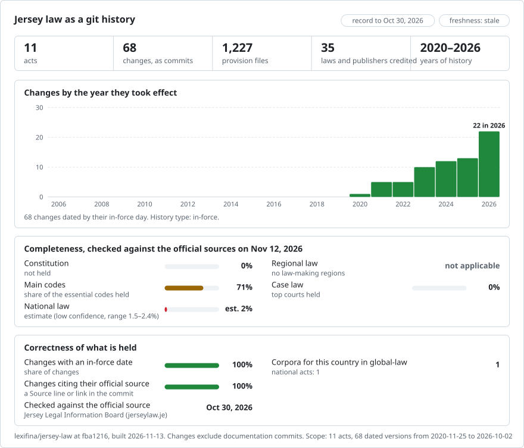

# Jersey: law history in git

<picture>
<source media="(prefers-color-scheme: dark)" srcset="data/effort-dark.svg">

</picture>

The law of Jersey as a git history: one file per Article or Schedule, one commit per version on the day it took effect, and the law that made each change as the commit's author. `git blame` names the law behind every paragraph; `git log` lists every change to an Article; picking a date gives the text in force that day.

Part of [lexifina/global-law](https://github.com/lexifina/global-law), one git history for every country's law: this is Jersey's national law, which global-law reads at `jersey/national/acts/`.

**What is in it now:** 11 Laws of the States of Jersey, among them the Employment, Companies, Data Protection, Human Rights and Interpretation Laws, with 50 official consolidated versions from 2020-11-25 to 2026-10-02 and 1,205 Articles and Schedules; 34 of the 57 changes after the first versions are credited to the 34 amending Laws, Regulations, Orders and Law Revision Board items that made them. [`REPRODUCE.md`](REPRODUCE.md) lists every Law with its versions; [`data/laws.csv`](data/laws.csv) lists the 45 laws in the record, with the day each amending law's change took effect.

Each Law is a folder named after its short title, with one file per Article or Schedule (`art-015-a.md` is Article 15A, `sch-02.md` Schedule 2), plus `long-title.md` and a `README.md` listing its provisions and their changes (`employment/art-001.md` is Article 1 of the Employment (Jersey) Law 2003, L.42/2003).

The text is in English, the language Jersey legislation is enacted in, as jerseylaw.je prints it.

## Questions as git commands

| Question | Command |
| --- | --- |
| Every change to Article 1 of the Employment Law | `git log -p --word-diff -- employment/art-001.md` |
| Which law wrote each line of Article 1? | `git blame employment/art-001.md` |
| Every change to the Employment Law, with the day each took effect and the law that made it | `git log --format="%h %(trailers:key=In-force,valueonly,separator=) %an" -- employment ':!employment/README.md'` |
| Article 1 as in force on 1 January 2026 | `python tools/on.py 2026-01-01 employment art-001` |

**Outside git**, we also host this record publicly, for free:

- **[Ask Claude about Jersey law](https://global-law.lexifina.com/v1/try_claude?country=jersey)**: opens Claude with a first question ready.
- **[Ask ChatGPT](https://global-law.lexifina.com/v1/try_chatgpt?country=jersey)**: the same question in ChatGPT.
- **[Search Jersey law on our site](https://lexifina.com/law?country=jersey&q=annual+leave)**: a search for "annual leave", with each provision's text and its versions, no account needed.
- **[Developer REST API](https://global-law.lexifina.com/v1/search_law?query=annual+leave&jurisdiction=jersey)**: the same search as JSON, with no key. See the [documentation here](https://lexifina.com/api/global-law).

Both assistants read the record through the free Global law connector (MCP, `https://global-law.lexifina.com/mcp`); the first time, the chat gives you the link that adds it. Ask in English.

**Host it yourself easily.** All it takes is git and Python, and the tools run on your machine:

```sh
git clone --depth 1 https://github.com/lexifina/global-law && cd global-law
python3 tools/countries.py add jersey/national/acts
python3 tools/law.py show 2026-01-01 jersey/national/acts/employment/art-001.md
```

Opened in Claude Code, Cursor, VS Code or Codex, the clone also starts a local MCP server with the same tools ([MCP.md](https://github.com/lexifina/global-law/blob/main/MCP.md)).

## Dates

Each commit is dated at noon, Europe/Jersey, on the day the version took effect, and carries it in its `In-force:` trailer:

- for every version, the "Showing the law from" day its official consolidation on jerseylaw.je states (Legislation (Jersey) Law 2021);
- for the first version of a Law, the day of the oldest consolidation published as text (2020-11-25 at the earliest), not the day the Law was enacted.

The first version is the "oldest version available", credited to the publisher (Jersey Legal Information Board) and naming the laws the source says produced it. A changed Article or Schedule is credited to an amending law (`Employment and Discrimination (Jersey) Amendment Law 2026 <l-11-2026@jerseylaw.je.invalid>`) only when that version's endnotes name the law for it and the version's day is one of the law's commencement days in its Table of Legislation History, or the day a Law Revision Board item revised it; any other change is the publisher's, and its message says it is unexplained.

## How it is checked

- Every version names its source page and the sha256 of the bytes it was read from (`data/versions.json`).
- `tools/check_repo.py` reads each of the 50 versions back from git on the day it took effect and on the day before, and compares it with the corpus: 0 mismatches (see [`REPRODUCE.md`](REPRODUCE.md)).
- Every commit's trailers parse; there are no merge commits, no commit dates that go backwards and none after the build. The same corpus always gives the same commit hashes; a second build has not yet been compared.
- History is append-only: `tools/append.py` adds new versions after the newest one and never replaces a published commit.
- [vulnerabilities/](vulnerabilities/): possible drafting mistakes in this law, found by global-law's detectors and checked by hand. Not run yet.

## What it does not show

- **Most Jersey law.** 11 Laws are here; other Laws, Regulations and Orders, case law and customary law are not. Jersey has no penal, civil or commercial code and no single constitutional text.
- **Laws as enacted.** Each history starts at the oldest consolidation jerseylaw.je publishes as text, which already holds the amendments made before it.
- **Who made every change.** 23 of the 57 changes are not credited to a law, because the endnotes and the Table of Legislation History do not tie them to one.
- **Headings and notes.** Part, division and cross headings, endnotes, history tables and footnote markers are not law text and are not in the files; tables inside Schedules are not kept as tables.
- **Versions after 2026-10-30**, when the record was retrieved.

## Sources

| Source | Kind | Past versions | Notes |
| --- | --- | --- | --- |
| [Jersey Law](https://www.jerseylaw.je) (Jersey Legal Information Board) | Official consolidated legislation | the current consolidation, and earlier copies of the same page | The text, the "Showing the law from" day of each version, and the endnotes and Table of Legislation History naming each amending law and its commencement |

## Licence

See [`LICENSE`](LICENSE). The States Assembly holds the copyright in Jersey legislation (Intellectual Property (Unregistered Rights) (Jersey) Law 2011, Articles 185 and 186), and the Greffier of the States offers it for re-use under the Open States Assembly Licence (OSAL-J) v.1; the arrangement, tables, commit messages and tools are by Lexifina, under CC BY 4.0.

No AI model wrote, translated or corrected legal text, and no model runs when the history is built; the scripts were written by an AI model (see [`REPRODUCE.md`](REPRODUCE.md)).

## Visualisations

- [visualisations/](visualisations/): charts drawn from this repository. Not drawn yet.

## More

From [lexifina/global-law](https://github.com/lexifina/global-law):

- [FEATURES.md](https://github.com/lexifina/global-law/blob/main/FEATURES.md): every feature, and what every corpus must support (`git blame`, `law.py`, the MCP tools)
- [FAQ.md](https://github.com/lexifina/global-law/blob/main/FAQ.md): questions and answers · [CONTRIBUTING.md](https://github.com/lexifina/global-law/blob/main/CONTRIBUTING.md): proposing changes · [MCP.md](https://github.com/lexifina/global-law/blob/main/MCP.md): the MCP server · [REPRODUCE.md](https://github.com/lexifina/global-law/blob/main/REPRODUCE.md): how it was built · [CHANGELOG.md](https://github.com/lexifina/global-law/blob/main/CHANGELOG.md)
- [FRESHNESS.md](https://github.com/lexifina/global-law/blob/main/FRESHNESS.md): how current each corpus is · [Monitoring](https://github.com/lexifina/global-law/tree/main/monitoring): whether updates are running · [WATCHING.md](https://github.com/lexifina/global-law/blob/main/WATCHING.md): how each official source is watched for changes
- [performance/](https://github.com/lexifina/global-law/tree/main/performance): how fast the tools are, measured
- [visualisations/](https://github.com/lexifina/global-law/tree/main/visualisations): charts and bridges across the world's law
- [Vulnerabilities](https://github.com/lexifina/global-law/tree/main/vulnerabilities): mistakes in legislation as published
